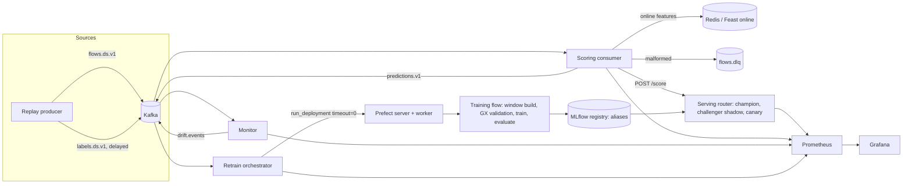

# DriftGuard: Real-Time Drift Detection Pipeline

DriftGuard is a streaming network intrusion detection service. It scores network flows from Kafka
in real time, monitors input drift, prediction drift, and performance drift, retrains
asynchronously when drift is confirmed, and promotes a new model only after it beats the current
model on live traffic in shadow mode and survives a canary stage. Every model change is reversible
with one command. It runs on two datasets that exercise two kinds of drift: CICIDS2017 (DistriNet
improved release), where new attack families appear on later days (abrupt drift), and Kyoto 2006+
(AnoShift subsets), which shifts naturally over ten years (gradual drift).

## Headline results

Every number below is generated from `results/*.json` by `make results`; a row reading "not yet
run" has no measured value. CI fails if these tables differ from what the renderer produces.

<!-- results:headline:start -->
| Guarantee | Measured result | Evidence |
|---|---|---|
| Sustained ingestion and p99 latency, with and without retraining | not yet run (`make loadtest`) | `results/e3_load.json` |
| Detection delay and false-alarm rate on injected shifts | not yet run (`make benchmark-drift`) | `results/e2_drift_detection.json` |
| PR-AUC recovery through gated retraining versus a static model | not yet run (`make eval-e4`) | `results/e4_adaptation.json` |
| Precision and recall at target recall, time-ordered | not yet run (`make eval-e1`) | `results/e1_model_quality.json` |
| Effect of stream-computed behavioral features | not yet run (`make eval-e1`) | `results/e1_model_quality.json` |
| No model serves without passing the gate; promote, decline, rollback | not yet run (`make eval-e5`) | `results/e5_gate.json` |
| Consumers scale on Kafka lag without duplicate or lost predictions | not yet run (`make loadtest-k8s`) | `results/e3b_k8s_autoscaling.json` |
<!-- results:headline:end -->

## Architecture



| Service | Role | Port |
|---|---|---|
| `kafka` | Event log (KRaft) | 9092 |
| `schema-registry` | Avro subjects, compatibility BACKWARD | 8081 |
| `redis` | Feast online store, idempotency keys, window state, rollout flags | 6379 |
| `producer` | Replay with event-time order, delayed labels, duplicate injection | n/a |
| `consumer` | Validation, dedup, stream features, scoring call, prediction log | 9101 |
| `serving` | ONNX Runtime router: champion, challenger shadow, canary split | 8001 |
| `monitor` | Windowed drift signals and the decision policy | 9102 |
| `orchestrator` | Debounced retraining triggers and the rollout controller | 9103 |
| `prefect-server`, `prefect-worker` | Retraining runs | 4200 |
| `mlflow` | Tracking and the model registry with aliases | 5000 |
| `prometheus`, `grafana` | Metrics, alerts, dashboards as code | 9090, 3000 |

**Why each service exists.** Kafka is the durable log that decouples producers, scoring, and
monitoring, and lets a crashed consumer resume without loss. The Schema Registry makes the Avro
contracts explicit and enforces backward compatibility. Redis holds everything that needs
low-latency shared state: the Feast online store, idempotency keys that turn at-least-once delivery
into effectively-once scoring, the sliding-window state of the stream features, and the rollout and
pause flags. The consumer scores but never trains, so ingestion stays fast. The serving router owns
model loading by MLflow alias, so promotion and rollback are alias moves, not deployments. The
monitor turns windows of traffic into drift signals and a versioned decision policy. The
orchestrator debounces and submits retraining without waiting and runs the shadow gate and canary
guardrails. Prefect runs the long training job outside the scoring path. MLflow records every model
version with its tags and holds the aliases. Prometheus and Grafana make the system observable and
drive the canary guardrails. See `docs/architecture.md`.

## Quickstart

```bash
make setup && make up && make demo
```

`make up` downloads the improved CICIDS2017 release when it is missing, fits the Great Expectations
bounds once, and starts the Compose stack. `make demo` bootstraps the initial champion, injects a
covariate shift into a real stream, and narrates detection, retraining, shadow evaluation, the gate
decision, and rollback. Copy `.env.example` to `.env` and set the three secrets first. The Compose
stack is sized for about 10 GB of free RAM and the Kubernetes stack for about 12 GB (the
specification's figures; neither has been measured yet).

## How it works

**Data layer.** Flows carry deterministic `uuid5` event ids, event time, and the allowlisted
features, and no label. Labels arrive on a separate topic after a delay of 2,000 to 10,000 events,
which is how intrusion labels arrive in practice. Identifier columns (flow id, IPs, source port,
timestamp) never reach the model, and for Kyoto the IDS, malware, and shellcode detector columns
are excluded because the labels derive from them. Both rules are unit-tested.

**Scoring consumer.** Avro decode, schema-level validation, Redis idempotency claims, Feast writes,
batched scoring (up to 256 events per call, 2 s timeout, 3 jittered retries), and the prediction log.
Failures go to `flows.dlq` with `error_type`, `error_msg`, `source_topic`, and `source_offset`. A
claim is a short lease that becomes a 48 h done key only after the prediction is flushed, so a
consumer killed mid-batch loses nothing and duplicates nothing.

**Stream features.** For CICIDS2017 the consumer computes per-source and per-destination
connection counts over 10 s and 60 s event-time windows, unique destination ports and hosts
(HyperLogLog), mean forward bytes, and SYN-flow share, using salted hashes of IPs as keys. Rows are
pushed online through a Feast `PushSource` and appended offline, so training reads exactly the
served values.

**Drift detection.** PSI with reference-quantile bins, an Evidently drift share, score PSI, KSWIN
on scores, and ADWIN on the delayed-label error. A versioned policy (`configs/drift_policy.yaml`)
flags a window when any signal crosses its threshold and emits a drift event after two consecutive
flagged windows, 2,000 labels since the last promotion, and a three-window cooldown. A failing
Great Expectations window never triggers retraining; it pauses it.

**Retraining.** The orchestrator submits the Prefect deployment with `timeout=0` and a concurrency
limit of one. The flow builds the newest labeled window with point-in-time features, validates it
with bounds fitted once, trains LightGBM with `scale_pos_weight` from the window, exports ONNX with a
parity check, compares champion and challenger on the same newest holdout, and registers the
challenger with tags.

**Promotion.** In shadow mode the consumer sends the same batches to the challenger, and both scores
land in one prediction record. After 3,000 labeled shadow events a paired bootstrap of the PR-AUC
difference decides: promote to canary only if the difference reaches 0.01 and the 95% interval lies
above zero. The canary serves 10% of traffic by a deterministic hash of the event id and is checked
against p99 latency, error rate, and positive-rate guardrails every 30 s. A breach rolls back
automatically; `make rollback DATASET=cicids2017` rolls back on demand.

## Evaluation

All runs write one JSON file to `results/` with the git SHA, config hash, environment, and hardware.
Throughput claims state their hardware and partition count.

### E1 Model quality (CICIDS2017)

Time-ordered results lead: the model trains on Monday to Wednesday and is tested on Thursday and
Friday, whose attack families never appear in training. A within-day split is a secondary view and
a random stratified split is an upper-bound reference only. Ablations drop `dst_port`, vary the
`attempted_policy` (default `benign`: rows labeled "Attempted" count as benign), and compare
CICFlowMeter features with and without the behavioral features. Reproduce with `make eval-e1`.

<!-- results:e1_model_quality:start -->
Not yet run. Reproduce with `make eval-e1`.
<!-- results:e1_model_quality:end -->

### E2 Drift detection benchmark

Shifts are injected into stationary base segments at a known onset; every detector and the
combined policy are scored on detection delay, false alarms, and misses. ADWIN depends on delayed
labels, so results are reported at label coverage 1.0 and 0.3. Reproduce with `make benchmark-drift`.

<!-- results:e2_drift_detection:start -->
Not yet run. Reproduce with `make benchmark-drift`.
<!-- results:e2_drift_detection:end -->

### E3 System load

Fixed-rate steps from 100 to 2,000 events per second, five minutes each, with the orchestrator
idle and with a retraining run forced mid-step, and with stream features on and off. Reproduce with
`make up && make bootstrap && make loadtest`.

<!-- results:e3_load:start -->
Not yet run. Reproduce with `make loadtest`.
<!-- results:e3_load:end -->

### E3b Kubernetes autoscaling

The kind stack (Strimzi, KEDA, kube-prometheus-stack, MLflow, Prefect, and the application pods)
is sized for about 12 GB of free RAM (not yet measured). `make k8s-up` refuses to start while the Compose stack or another
kind cluster is running. On a local kind cluster the load holds at 250 events/s, steps to 2,000
events/s, and drops back; KEDA scales the consumers on lag. Reproduce with `make k8s-up &&
make loadtest-k8s`.

<!-- results:e3b_k8s_autoscaling:start -->
Not yet run. Reproduce with `make loadtest-k8s`.
<!-- results:e3b_k8s_autoscaling:end -->

### ONNX Runtime latency

<!-- results:onnx_latency:start -->
Not yet run. Reproduce with `make benchmark-onnx`.
<!-- results:onnx_latency:end -->

### E4 End-to-end adaptation

Kyoto streams 2008 to 2015 twice from the same initial champion: once with retraining paused
(static) and once with the full policy (adaptive). CICIDS2017 streams the full week with the
policy enabled. Reproduce with `make eval-e4` (drives the live stack; several hours).

<!-- results:e4_adaptation:start -->
Not yet run. Reproduce with `make eval-e4`.
<!-- results:e4_adaptation:end -->

### E5 Promotion gate correctness

Three synthetic challengers go through the shadow gate against one champion on the same 3,000
labeled events: clearly better (trained on post-drift data), equal (same data and seed), and worse
(shuffled labels). Every alias change in a live run is appended to `results/promotions.jsonl`.
Reproduce with `make eval-e5`.

<!-- results:e5_gate:start -->
Not yet run. Reproduce with `make eval-e5`.
<!-- results:e5_gate:end -->

### First version (historical, transcribed)

These numbers come from the earlier synchronous design and a different split than E1. They are
shown as history, not as results of this system.

<!-- results:v1_verified_run:start -->
| Claim (v1, historical) | Value | Source |
|---|---|---|
| Flows processed by the replay (original CICIDS2017, 5 days) | 863,882 | Producer log, final verification run (commit d0f531e) |
| Invalid rows dropped (negative CICFlowMeter values) | 3 | Preprocessing log, final verification run (commit d0f531e) |
| scale_pos_weight computed from training labels | 30.9120 | Training log, final verification run (commit d0f531e) |
| Test PR-AUC (chronological 75/15/10 split) | 0.1625 | Training log, final verification run (commit d0f531e) |
| Test ROC-AUC (chronological 75/15/10 split) | 0.9383 | Training log, final verification run (commit d0f531e) |
| Precision at recall-calibrated threshold 0.0298 | 0.1719 | Training log, final verification run (commit d0f531e) |
| Recall at recall-calibrated threshold 0.0298 (target 0.95) | 0.9555 | Training log, final verification run (commit d0f531e) |
| PSI trigger window and max PSI | window_0501, max PSI 0.2606 | Consumer log, final verification run (commit d0f531e) |
| Retraining flows started / reached model comparison / aborted at validation | 535 / 534 / 0 | Prefect logs, final verification run (commit d0f531e) |
| Promotions in the live run | 0 | Final verification run; deterministic retraining on identical data |
| Consumer throughput with synchronous retraining (msg/s) | about 250 before, about 64 with retraining completing | Final verification run (commit d0f531e) |

_Transcribed, not re-measured: historical numbers from IMPLEMENTATION_REPORT.md (private, not committed), final verification run at commit d0f531e; split: Chronological 75/15/10 percentile split over the five concatenated original CICIDS2017 TrafficLabelling days (Monday to Friday): train rows 0 to P75, test P75 to P90, stream P90 to end. Not the SPEC E1 protocol (Monday to Wednesday train, Thursday and Friday test)._

_Source: `results/v1_verified_run.json`, run `2026-10-15T00-48-08Z_v1_verified_run`, git `98ff03d`, hardware: arm, 10 logical CPUs._
<!-- results:v1_verified_run:end -->

## Design decisions

`DECISIONS.md` records each significant choice with its alternatives. The main ones:
asynchronous retraining through a Prefect deployment (D-007), leased idempotency claims (D-003),
alias-based serving and rollback (D-005), a paired-bootstrap promotion gate, Redis for window state
instead of a JVM stream processor (D-014), and a partitioned-parquet offline store behind the
Feast `PushSource` (D-006).

## Limitations

- No result in this repository is a claim until its `results/*.json` exists; tables read "not yet
  run" until then. The first version's numbers were measured on a different split.
- The source of the earlier "98% precision at 99% recall" figure could not be traced. E1 reports
  precision at recall 0.99 for every protocol so the figure can be matched to a split.
- The initial champion is the only model that serves without passing the gate, because there is no
  incumbent to compare it against.
- The model capacity (100 trees) was chosen by a validation-only criterion after an E1 diagnostic
  that looked at test-day per-family recall, so E1's test numbers are not perfectly untouched by
  that investigation (DECISIONS D-019).
- Shadow pairs are held in the rollout controller's memory; a restart during shadow evaluation
  restarts the collection.
- Idempotency keys expire after 48 h, so a replay older than that can be scored again.
- Window state in Redis expires on wall-clock TTLs, so a replay much slower than real time can
  expire window members early.
- Kyoto features are discretized by AnoShift, so PSI bins collapse onto those levels; the 2006
  subset is dominated by attacks.
- E2 runs offline on shuffled base segments and uses event-count windows for both datasets; live
  Kyoto monitoring uses calendar months.
- Kafka runs a single broker with replication factor 1, and the kind cluster is a single node.
- Evidently costs about 0.6 s per window at the default sample size, which bounds how fast the
  monitor can close windows on large streams.
- The training flow's Great Expectations check uses the specified fitted percentile bounds, which
  reject drifted windows such as real Thursday and Friday CICIDS2017 traffic as data-quality
  failures; the alternative (`gx.training_bounds: physical_bounds`) changes a stated rule and is an
  open decision (DECISIONS D-022). The monitor's suite checks data quality only.
- KSWIN tests one score in 100 (policy version 4) because per-event tests fire in nearly every
  stationary window; it needs about 50,000 events before its first test (D-020).
- Stream features cost about 18 Redis commands per event so that they do not depend on how Kafka
  splits polls (D-011); E3 reports the resulting throughput.
- The Compose and Kubernetes stacks, the integration and end-to-end tests, E3, E3b, E4, the demo,
  and CI have never been run: development had no container runtime. The Helm chart passes
  `helm lint`, `helm template`, and kubeconform but has never been installed on a cluster.
- On the Kyoto subsets the attack share of the base period is high (about 60%), so the prior-shift
  benchmark there lowers the attack proportion instead of raising it.

## Repository layout

```
src/driftguard/
  data/          adapters (cicids2017, kyoto), ids, Avro schemas, serde, synthetic flows
  producer/      replay, rate limiting, delayed labels and duplicates
  consumer/      main loop, validation, idempotency, DLQ, scoring client, sinks
  serving/       FastAPI router, model store with alias watcher, admin
  monitor/       PSI, windows, detectors, policy, reference, service
  orchestrator/  triggers, rollout controller, service
  training/      window, validation, train, export, evaluate, gate, flow
  streamfeatures/ keys, windows, HyperLogLog, push, replay
  features/      Feast store and the partitioned offline store
  benchmark/     injector, E1 to E5 drivers, load tests, figures
  common/        settings, logging, metrics, results, rendering, MLflow client
configs/         YAML configs, one file per concern (data, eval, policy, rollout, model)
deploy/k8s/      kind config, Strimzi, KEDA, Helm chart
docker/          application image
flows/           Prefect flow entrypoint
prometheus/ grafana/   alerts, scrape config, provisioning, generated dashboards
scripts/         thin CLI entry points
tests/           unit, integration, e2e
results/         JSON artifacts and figures rendered into this README
docs/            architecture.md, runbook.md, demo.md
```
