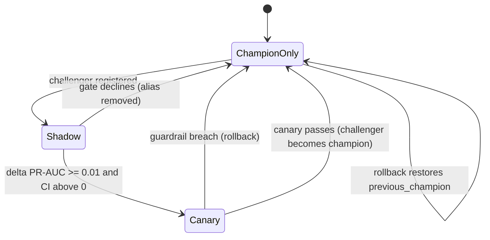

# Architecture

DriftGuard separates scoring, monitoring, retraining, and rollout so that none of them can slow or
break another. This document explains why each component exists and which guarantee it backs.

## Data flow

1. The **replay producer** emits flows to `flows.<dataset>.v1` in event-time order, and each flow's
   label to `labels.<dataset>.v1` after a delay measured in events. Flows carry no label.
2. The **scoring consumer** (group `driftguard-scoring`, manual commits, cooperative-sticky
   assignment) decodes, validates, claims idempotency keys, computes stream features, writes Feast
   rows, calls the serving router, and produces `predictions.v1`. It commits offsets only after the
   predictions are flushed.
3. The **serving router** scores batches with ONNX Runtime. In shadow mode the challenger scores
   the same batch through `/score/shadow`; in canary mode a SHA-256 hash of the event id sends a
   fixed share to the challenger.
4. The **monitor** reads flows, predictions, and labels, closes windows, computes drift signals,
   applies the policy, and emits `drift.events`.
5. The **orchestrator** consumes drift events and submits the Prefect retraining deployment
   without waiting. Its rollout controller reads predictions and labels, runs the shadow gate and
   the canary guardrails, and moves MLflow aliases.
6. The **training flow** builds the newest labeled window, validates it, trains, exports ONNX,
   evaluates champion and challenger on the same holdout, and registers the challenger.

## Why each service

| Service | Why it exists | Guarantee it backs |
|---|---|---|
| Kafka | Durable ordered log; consumers resume after a crash | At-least-once processing |
| Schema Registry | Versioned Avro contracts with BACKWARD compatibility | Safe schema evolution |
| Redis | Shared low-latency state: Feast online store, idempotency keys, window state, rollout and pause flags | Effectively-once scoring, stream features |
| Consumer | Scoring path with no training code and no blocking on retraining | Throughput during retraining |
| Serving router | Alias-based model loading, shadow and canary routing, admin API | Gated promotion, one-command rollback |
| Monitor | Windowed signals and a versioned policy | Drift detection with known delay and false-alarm rate |
| Orchestrator | Debounced triggers, shadow gate, canary guardrails | No model serves without passing the gate |
| Prefect server and worker | Runs training outside the scoring path with a concurrency limit | Bounded retraining |
| MLflow | Registry with aliases, tags, and run history | Reversible model changes |
| Prometheus and Grafana | Metrics, alerts, dashboards, and the canary guardrail queries | Observability |

## Training-serving consistency

The consumer writes each event's features to the Feast online store and appends the same rows to
date-partitioned parquet, stamped with the flow's event time. Training reads them back with
point-in-time joins, so a model trains on the values it would have seen at serving time. Behavioral
features follow the same path through a `PushSource`.

## Idempotency

A claim is `SET dg:seen:{event_id} pending:<owner> NX EX 30`. After the prediction is flushed the key
becomes `1` with a 48 h TTL. A redelivered event is a duplicate when its key is `1`; a pending key
whose lease expired is reclaimed, so events claimed by a crashed consumer are scored by its
successor. Idempotency keys absorb redelivery after a rebalance, which is what makes lag-based
autoscaling safe.

## Model lifecycle

## Kubernetes

The same images run on kind. Strimzi runs Kafka in KRaft mode with the topics as `KafkaTopic`
resources. A KEDA ScaledObject scales the consumer deployment from 1 to 6 replicas (the partition
count) on lag with a threshold of 5,000. Serving runs two replicas with a PodDisruptionBudget and a
CPU HPA. ServiceMonitors, a PrometheusRule, and a dashboards ConfigMap come from the same files as
the Compose stack.
